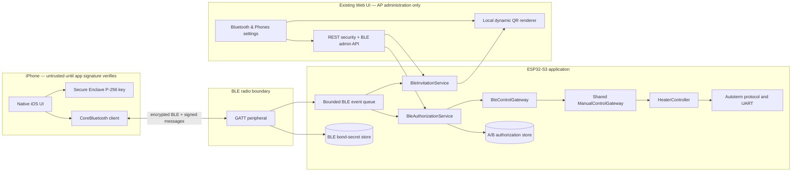
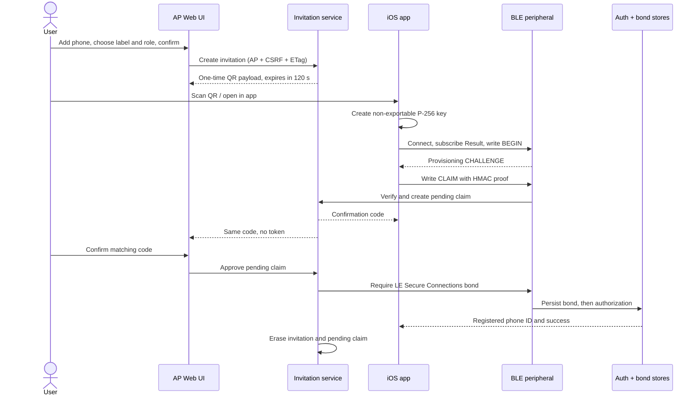
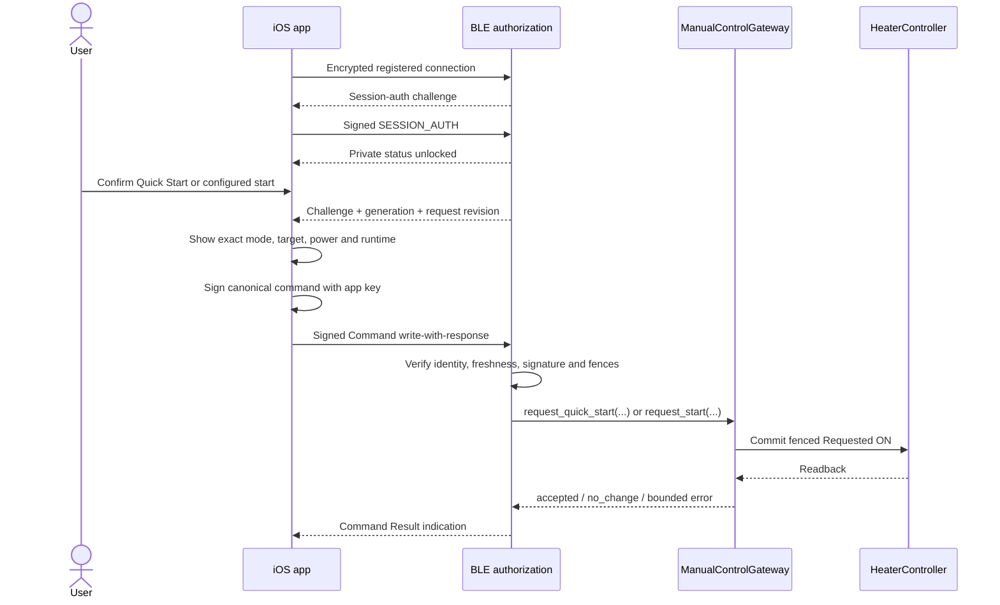

# Landy Heater — BLE and iOS control architecture

- Status: **proposed architecture; not implemented**
- Target hardware: DFRobot FireBeetle 2 ESP32-S3-U / DFR0975-U N16R8
- Target client: native iOS application using CoreBluetooth
- Last updated: 2026-11-22

This document defines the intended architecture for controlling the Landy
Heater over Bluetooth Low Energy (BLE). It is an implementation contract, not
an authorization to change, build, flash or provision the controller.

The key product decisions are:

- more than one iPhone may be registered;
- phone administration and every pairing QR code live in the existing Web UI;
- there is no static pairing QR code on the controller;
- BLE pairing alone never authorizes a heater command;
- under an authentic-firmware threat model, every command is authorized by a
  registered per-installation application key and a fresh controller
  challenge;
- all BLE start, stop and session changes pass through the existing
  `ManualControlGateway` and never access the heater UART directly;
- proximity, RSSI, reconnect and geofencing must never start the heater;
- pairing and recovery are deliberately initiated and confirmed in the
  AP-only Web UI; no hardware button or additional GPIO is required.

## 1. Scope

### 1.1 Included

This architecture covers:

- a native iOS app for status and manual heater control;
- registration of up to five independent phone/app installations;
- dynamic, short-lived, single-use pairing invitations from the AP Web UI;
- selective revocation and role changes from the AP Web UI;
- BLE service, GATT contracts and signed command envelopes;
- persistence, replay protection, failure containment and recovery;
- coexistence with the existing Wi-Fi, Web, scheduler and heater runtime;
- staged implementation, security gates and target acceptance tests.

### 1.2 Explicitly excluded

The first version does not include:

- automatic start based on proximity, RSSI, geofence, CarPlay or reconnect;
- configuration mutation over BLE;
- timer administration over BLE;
- cloud relay, remote Internet access or user accounts;
- Android support;
- transfer of a phone identity through iCloud or a device backup;
- treating radio range as a security boundary;
- changing the heater protocol or bypassing current Requested-State rules.

## 2. Existing system constraints

The design is an extension of the current product, not a parallel controller.

1. `ManualControlGateway` is the only manual control boundary. Its generation,
   Requested-State revision, availability and rollback checks remain
   authoritative.
2. `ProductRuntime` is cooperative. The heater owner must receive its bounded
   step even if BLE, Wi-Fi, HTTP, discovery or diagnostics fail.
3. Durable configuration uses verified, bounded storage and optimistic
   concurrency. BLE authorization follows the same principles, but has its own
   store and generation.
4. Persistent administration is available only on the access-point listener
   and keeps the existing Host, same-origin, CSRF and rate-limit protections.
5. The current firmware already contains NimBLE, a peripheral/GATT-server
   build, 2M and coded PHY support, and Wi-Fi/BLE coexistence. That is only a
   capability baseline, not an accepted BLE security configuration.

The currently retained build has about 874 kB of application-slot headroom.
Internal RAM is the more important limit because the current NimBLE build uses
internal allocation while Wi-Fi, HTTP, MicroPython and the heater runtime are
also active.

The retained SDK configuration is not suitable for production BLE control as
it stands: it allows four connections but only three bonds, legacy pairing is
enabled, Secure-Connections-only is disabled, the configured security level
is zero and NimBLE secret persistence is disabled. Secure Boot and Flash
Encryption are also not enabled. These are implementation inputs, not settings
to change as part of this architecture document.

Relevant implementation anchors:

| Concern | Existing contract |
| --- | --- |
| Manual control authority | [`app/manual_control_gateway.py`](app/manual_control_gateway.py) |
| Current gateway construction | [`app/rest_composition.py`](app/rest_composition.py) |
| Cooperative lifecycle/priority | [`app/product_runtime.py`](app/product_runtime.py) |
| AP/STA, Host, Origin and CSRF policy | [`services/rest_security.py`](services/rest_security.py) |
| HTTP mutation quotas | [`services/rest_rate_limiter.py`](services/rest_rate_limiter.py) |
| Configuration generation and limits | [`services/config_manager.py`](services/config_manager.py) |
| Atomic A/B storage pattern | [`adapters/config_file_store.py`](adapters/config_file_store.py) |
| Settings/OpenAPI integration | [`web/settings.js`](web/settings.js) and [`web/openapi.json`](web/openapi.json) |
| Target-board and memory evidence | [`DFR0975U_MIGRATION.md`](DFR0975U_MIGRATION.md) |
| Retained BLE/build facts | [`sdkconfig`](firmware/phase13_heater_frozen/artifacts/sdkconfig) and [`BUILD_INFO.md`](firmware/phase13_heater_frozen/BUILD_INFO.md) |

## 3. Safety and security invariants

An implementation is conformant only while all of these invariants hold.

1. No BLE `START`, `QUICK_START` or session extension is accepted without an
   enabled registered phone, an allowed role, an encrypted link, a fresh
   challenge, a valid application signature and current state fences.
2. BLE never calls `HeaterController`, a protocol port or UART directly.
3. The same `ManualControlGateway` instance is shared by REST and BLE.
4. A BLE bond is transport protection, not heater authorization. A bonded but
   unregistered peer has no command rights.
5. Each app installation has its own non-exportable P-256 private key. The
   controller stores only the corresponding public key and metadata.
6. Revocation takes effect in the authorization store before bond deletion.
   A stale bond must therefore be harmless.
7. Pairing is closed by default and opens only after an explicit Add Phone
   action in the AP-only Web UI.
8. Invitations are short-lived, single-use, RAM-only and invalid after reboot.
9. A corrupt, unknown or unavailable BLE authorization store fails closed for
   BLE commands. It never creates an implicit first-owner state.
10. `STOP` remains a safety operation and is not fenced by configuration
    generation or Requested-State revision, but it still requires a registered
    signed BLE request. Existing Web and local stop paths remain unchanged.
11. No RSSI value, radio reconnect or background event can create Requested
    ON.
12. Advertising and unauthenticated capabilities reveal no heater state,
    phone name, role, Wi-Fi data or invitation secret.
13. A BLE failure may disable BLE, but may not crash or block heater
    supervision, Wi-Fi recovery or the existing Web UI.
14. A BLE bond is shared by iOS at the operating-system level. Private status
    is exposed only after the app has also proven possession of its registered
    private key for the current connection.

## 4. Trust boundaries and component model



### 4.1 Firmware responsibilities

`MicropythonBlePeripheral`

- owns `bluetooth.BLE`, advertising, connections, GATT registration and SMP
  callbacks;
- copies only bounded primitive events into a fixed queue from BLE IRQ context;
- never parses a command, writes storage or calls application logic in IRQ
  context;
- exposes a deterministic `start()`, `step()`, `snapshot()` and `deinit()`
  lifecycle.

`BleAuthorizationStore`

- persists the bounded public phone registry through an atomic A/B pattern;
- owns schema validation, generation and authorization epoch;
- contains no invitation tokens and no NimBLE Long Term Keys.

`BleBondSecretStore`

- satisfies the MicroPython/NimBLE secret callbacks using a separate bounded
  secret store;
- stores identity resolving keys and bond material only;
- supports enumeration and deletion by an opaque `bond_ref`;
- is covered by the later Flash Encryption decision.

`BleAuthorizationService`

- resolves phone IDs, roles, enabled state and public keys;
- verifies canonical P-256/SHA-256 signatures;
- owns challenges, rate limits and authorization result normalization;
- reconciles orphaned bonds and incomplete revocations at boot.

`BleInvitationService`

- owns one in-memory invitation and one pending claim;
- accepts invitation creation only through the AP-admin Web boundary;
- verifies the invitation HMAC proof;
- binds a pending claim to one connection handle, provisioning challenge,
  public key and transcript until that exact connection is bonded;
- exposes only safe invitation state to the Web UI.

`BleControlGateway`

- parses the fixed BLE command envelope;
- performs authorization and freshness checks in the required order;
- maps accepted commands to the shared `ManualControlGateway`;
- normalizes application exceptions to bounded BLE result codes.

`BleComposition`

- builds the BLE owners with injected clock, RNG, stores and shared gateway;
- is disabled by default until its implementation phase is explicitly
  released;
- exposes one degradable owner to `ProductRuntime`.

### 4.2 Required composition refactor

Today the REST composition constructs its own `ManualControlGateway`. Before
BLE control is enabled, ownership must move one level upward so product
composition creates exactly one instance and injects it into both REST and
BLE. Creating a second gateway is prohibited: it would split the operation and
fault guards around the same Requested State.

The intended dependency is:

```text
Product composition
    └── one ManualControlGateway
        ├── RestApplication
        └── BleControlGateway
```

## 5. Phone identity, roles and limits

### 5.1 Identity

Each iOS app installation creates one P-256 key pair per controller. The
private key is created in the Secure Enclave, is non-exportable and uses a
`ThisDeviceOnly` accessibility class. It is not placed in a shared Keychain
access group and is not synchronized through iCloud. A production app must
fail closed for control if the required hardware-backed key is unavailable;
software-key fallback is permitted only in explicitly marked development and
simulator builds.

The controller stores the ANSI X9.63 uncompressed public key returned by iOS,
exactly 65 bytes (`0x04 || X || Y`), after validating that it is a P-256 point.
This avoids custom point-compression code in the app. A random 16-byte
`phone_id` identifies the registration; labels are presentation data and never
authorization inputs.

Reinstalling the app, replacing the phone or restoring to another device
creates a new key and requires a new invitation.

### 5.2 Roles

| Role | Read authenticated status | Start / Quick Start / Stop | Change active session |
| --- | ---: | ---: | ---: |
| `owner` | yes | yes | yes |
| `driver` | yes | yes | yes |
| `viewer` | yes | no | no |

All phone administration remains in the AP Web UI; no role exposes registry
mutation through BLE. The `owner` role preserves an explicit administrative
identity and the last-owner recovery invariant, but does not have to sign Web
administration actions.
Version 1 uses protected AP network access, AP-bound ingress, Origin/CSRF,
ETag concurrency and explicit Web confirmation as its administration
authority; it does not claim a separate HTTP user login, owner-phone signature
or hardware-presence factor.

Registry invariants:

- at most five registered phones;
- at most one simultaneous BLE connection in version 1;
- the first registered phone is an `owner`;
- while any phone exists, at least one enabled owner must remain;
- duplicate public keys, phone IDs and bond references are rejected;
- labels are at most 32 UTF-8 bytes after normalization;
- `last_seen` is RAM-only to avoid flash wear.

If the app is reinstalled while iOS retains the old system bond, the new app
key is not silently attached to that bond. The old Web entry must first be
revoked, its bond removed/re-established, and a new invitation completed.

## 6. Persistent authorization model

BLE authorization is not added to the general configuration document. It uses
its own bounded A/B store, for example `/landy_heater_ble_auth`, with a maximum
serialized size of 4 KiB.

Conceptual schema:

```json
{
  "schema_version": 1,
  "authorization_epoch": 4,
  "device_id": "32-lowercase-hex",
  "phones": [
    {
      "id": "32-lowercase-hex",
      "label": "Fabians iPhone",
      "role": "owner",
      "public_key": "base64url-p256-x963-key",
      "bond_ref": "opaque-bounded-reference",
      "enabled": true
    }
  ]
}
```

The JSON above is the A/B payload; the authoritative `generation` comes from
the validated storage envelope and is not duplicated inside the payload. It
changes for every registry mutation and forms the Web ETag `"ble-auth-N"`.
`authorization_epoch` changes whenever a security-relevant mutation can
invalidate an in-flight command. A label-only update need not change the
epoch. Both counters are bounded by `0x7fffffff` and exhaustion fails closed.

`device_id` is a random 128-bit value created while bootstrapping the first
trusted empty store, is not derived from a Wi-Fi/BLE MAC address and survives
BLE recovery reset. A key fingerprint is derived from the public key when
needed and is not redundantly persisted. `bond_ref` is unique, opaque ASCII of
at most 64 bytes and may not contain whitespace, slash or NUL. REST never
returns `public_key` or `bond_ref`.

On first enable or migration, the controller must create and read back two
valid consecutive A/B records with the same empty payload and stable
`device_id` before making BLE administration available. Following the current
store trust pattern, generations 1 and 2 establish the initial redundant
state, so the first invitation uses ETag `"ble-auth-2"`. Failure to create or
validate both records makes BLE unavailable; it never opens implicit
enrollment. The canonical payload limit is 4 KiB and the complete storage
record limit is separately fixed at 8 KiB.

### 6.1 Safe registration ordering

Rights become active only after all preceding steps succeed:

1. verify invitation, target key and Web confirmation;
2. establish LE Secure Connections and persist its bond;
3. write the authorization entry atomically;
4. read back and validate the committed registry;
5. close the invitation and expose success.

If power is lost before step 3, the result is an orphaned bond with no command
rights. Boot reconciliation removes it. The final commit still uses the
invitation's captured expected generation; any intervening registry change
aborts authorization and schedules the new bond for removal.

### 6.2 Safe revocation ordering

1. atomically persist `enabled: false` and increment the authorization epoch;
2. disconnect the peer if connected;
3. delete the associated bond;
4. atomically remove the authorization entry, unless a bounded tombstone is
   required for retry.

Power loss can leave an old bond, but cannot leave old authorization active.

## 7. AP-only Web administration — no hardware button

Pairing and recovery are initiated entirely in the existing Web UI. A hardware
button, onboard key, additional GPIO and `PhysicalPresenceProvider` are not
part of this architecture.

The administrative security boundary is therefore the combination of:

- access to the controller's protected AP network;
- a request received on the AP-bound listener, never the station listener;
- valid Host and same-origin checks;
- the boot-ephemeral CSRF token;
- the current BLE authorization ETag;
- an explicit action and confirmation in the Web UI;
- invitation and administration rate limits.

Clicking **Add phone** creates the short-lived invitation directly after the
user confirms the selected label and role. The QR token, pending-claim code and
final registration protections defined below remain unchanged.

Recovery uses a separate **Reset all Bluetooth phones** action. It is enabled
only while Requested State is OFF and no heater transition is active. The Web
UI's first action requests a 60-second boot-ephemeral recovery nonce and opens
a modal showing the destructive consequence. The second confirmation echoes
that nonce in the reset request. Recovery never changes Wi-Fi, heater or timer
configuration.

This is an explicit security tradeoff: anyone who obtains the AP credentials
and can satisfy the browser Origin/CSRF checks can administer BLE phones or
reset their registry. The AP password must therefore be unique and strong, and
must be changed if disclosure is suspected. Version 1 does not add an owner-
phone signature or hardware-presence factor.

## 8. Dynamic invitation and QR-code flow

There is no static QR code. The QR code is generated only after the user clicks
and confirms **Add phone** inside the AP-only Web UI.

### 8.1 Invitation properties

- one active invitation at a time;
- 16-byte random `invitation_id`;
- 32-byte random invitation token;
- 120-second monotonic lifetime;
- role and label fixed by the server-side invitation;
- when the registry is empty, the server requires/forces role `owner`;
- token and claim state held only in RAM;
- invalid after reboot, cancel, success or three invalid proofs;
- the provisioning challenge is single-use, expires after 15 seconds and is
  bound to the connection on which the claim is received;
- a valid pending claim remains bound to that same live connection; disconnect
  before the resulting bond is persisted cancels the invitation;
- QR response sent with `Cache-Control: no-store`;
- token never written to logs, diagnostics, `localStorage`, service-worker
  caches or persistent browser state;
- QR image rendered locally from the returned payload, with no CDN.

Version-1 compact payload:

```text
ASCII "lhc-pair/v1:" || base64url(canonical-payload, no padding)

canonical-payload =
    version             u8, value 1
    device_id           16 bytes
    invitation_id       16 bytes
    invitation_token    32 bytes
    service_uuid        16 bytes, RFC 4122 network byte order
```

The controller, not an expiry value inside the QR code, decides whether an
invitation is still live.

### 8.2 Claim proof

After scanning, the app creates its key pair, connects to the advertised
service and subscribes to `Provisioning Result`. Provisioning uses this
write/indicate dialogue on the existing two characteristics:

```text
Provisioning Control: BEGIN(version, device_id, invitation_id,
                            app_nonce[16], x963_public_key[65])
Provisioning Result:  CHALLENGE(provisioning_challenge[32])
Provisioning Control: CLAIM(claim_proof[32])
Provisioning Result:  CLAIM_PENDING(confirmation_code) or ERROR(code)
Web confirmation:     out-of-band REST action
Provisioning Result:  BOND_REQUIRED, then REGISTERED(phone_id) or ERROR(code)
```

All fields, opcodes and lengths are fixed in the BLE-0 protocol specification;
unknown versions/opcodes and non-exact lengths are rejected. The claim proof
is:

```text
HMAC-SHA256(
    invitation_token,
    ASCII "LHC-PAIR-CLAIM-v1\0" ||
    version || device_id || invitation_id ||
    provisioning_challenge || app_nonce || x963_public_key
)
```

The app cannot select its role; role and label come from the invitation stored
on the controller. The raw token is not sent over GATT.

After a valid claim, both the iOS app and the Web UI display the same short
confirmation code derived from the first four bytes of
`HMAC-SHA256(invitation_token, "LHC-PAIR-CONFIRM-v1\0" || full_claim_transcript)`
and rendered as eight uppercase hexadecimal characters grouped `XXXX-XXXX`.
All HMAC comparisons are constant-time. The registry is not committed until
the user explicitly enters/confirms that exact code in the Web UI. This both
proves that the BLE peer knows the one-time token and protects against a leaked
or intercepted QR payload being silently claimed by the wrong app.

Confirmation authorizes pairing only on the connection that supplied that
claim. The peripheral rejects pairing requests at all other times and verifies
that the persisted `bond_ref` belongs to that same connection before committing
the phone registry entry.

### 8.3 Pairing sequence



### 8.4 Pairing from the same iPhone

An iPhone cannot scan a QR code shown on its own screen. The Web card therefore
also offers **Open in Landy Heater**.

The preferred handoff is a Universal Link whose sensitive payload is in the
URL fragment so it is not sent to a Web server. A custom URL scheme may be
used only as a transport fallback; it is not a trust anchor because another
app may register the scheme. In both cases the pending-claim confirmation code
must still be checked in the Web UI before rights are committed.

The product domain, Associated Domains entitlement and offline behavior must
be settled in an ADR before implementing same-phone handoff. Until then, a QR
scan from a second screen is the accepted provisioning path.

## 9. BLE transport and GATT contract

### 9.1 Link policy

- ESP32 operates as peripheral/GATT server only in version 1;
- exactly one simultaneous connection;
- LE Secure Connections required and legacy pairing disabled;
- an encrypted link is required for challenge, command, command result and
  authenticated status;
- provisioning control/result may be used before bonding only while an active
  invitation exists. It accepts no heater operation, reveals no private state
  and relies on the invitation HMAC plus Web confirmation; the bond must be
  encrypted and durably persisted before authorization is committed;
- because the controller has no trusted display/keypad, SMP may still use a
  Just Works association. Application proof and signatures remain the actual
  authorization boundary;
- resolvable private addresses are preferred after bonding;
- advertising contains only service UUID, protocol version and coarse
  availability flags;
- preferred ATT MTU is 256, with an application payload maximum of 224 bytes;
- no mutation uses `Write Without Response`;
- unused central, observer, GATT-client and stock service roles should be
  removed from the production build after capability testing.

Advertising behavior is explicit:

- when BLE is disabled, the peripheral is stopped and no BLE service is
  advertised;
- with registered phones, normal connectable advertising permits control
  attempts but authorization still occurs after connection;
- with no registered phone and no invitation, the controller exposes no open
  provisioning path;
- an active invitation temporarily permits one unknown peer to reach only the
  provisioning characteristics;
- outside an active invitation the controller accept list restricts normal
  connections to known bonded identities; it never replaces the public-key
  authorization check;
- an unknown invitation peer has 10 seconds to submit its first valid proof and
  is disconnected on timeout; a known peer has 10 seconds after link encryption
  to complete app-session authentication;
- unauthenticated connections have a 15-second absolute lifetime. Authenticated
  idle and subscription timeouts are bounded separately so the single
  connection slot cannot be held forever.

### 9.2 Provisional version-1 UUID allocation

These UUIDs are provisionally reserved by this architecture. BLE-0 may replace
them only through the protocol ADR before released firmware or an app uses
them. Once that ADR and its golden vectors are accepted, they are immutable and
must not be reused for a different semantic contract.

| Item | UUID | Properties | Maximum value | Purpose |
| --- | --- | --- | ---: | --- |
| Landy Heater Control service | `1e9f1218-8a92-469c-ad7b-37edb5f9aae7` | primary | — | Versioned service root |
| Capabilities | `83e795fc-101a-4feb-97b3-e34b5ff2f0af` | read | 64 B | Version, device digest, limits, flags |
| Provisioning Control | `b15c57a1-b86c-423c-bc04-3268ec756cda` | write with response | 224 B | Claim an active invitation |
| Provisioning Result | `87717a61-1486-4014-9e56-cbe232f1a3ec` | indicate | 224 B | Claim/bond result and confirmation code |
| Challenge | `2c8fc136-d51b-422e-8e26-02e8de613321` | read, indicate | 96 B | Fresh command challenge and fences |
| Command | `42b6c714-d6fe-4503-a4bc-cdf52d503e72` | write with response | 224 B | Signed command envelope |
| Command Result | `45fc2e30-8277-428b-89af-314cbe0b1f3e` | indicate | 224 B | Bounded command outcome |
| Status | `fb1f4e3d-84c4-4ed7-8ba5-bf762a7a8e91` | read, notify | 192 B | Private runtime projection after app authentication |

CCCD subscription, an iOS bond and connection encryption do not grant access
by themselves. After link encryption, the app obtains a challenge and submits
a signed `SESSION_AUTH` envelope. Only a valid signature marks that connection
as app-authenticated and unlocks private status/notifications. Heater commands
each require a second, fresh challenge and signature.

The complete byte layouts and numeric IDs for Capabilities, Provisioning
Control/Result, Challenge, Command Result and Status belong in a normative
`BLE_PROTOCOL_V1.md` produced and accepted during BLE-0. It must define
fragment/read-offset behavior, indication correlation by `challenge_id`,
required result subscriptions and recovery from a lost result. A client never
blindly repeats a start after losing its result; it reads authenticated status
and fresh state first.

## 10. Signed command protocol

### 10.1 Why a separate application signature is required

BLE bonding answers whether this is a previously bonded radio peer. It does
not prove that the Landy Heater app instance currently issuing a start owns the
registered application key. A signed, challenge-bound command provides that
proof and permits independent revocation even if an old bond remains.

### 10.2 Canonical envelope

Version 1 uses a fixed binary representation in network byte order. It does
not sign JSON and permits no alternate encodings.

```text
magic                       4 bytes   "LHCB"
protocol_version            u8        1
command_type                u8
flags                       u16       must be zero in v1
device_id                   16 bytes
phone_id                    16 bytes
authorization_epoch         u32
boot_session_id             16 bytes
challenge_id                u32
challenge_nonce             32 bytes
expected_config_generation  u32
expected_request_revision   u64
payload_length              u16
command_payload             0..40 bytes, exact by command type
signature                   64 bytes  P-256 ECDSA r || s
```

The signature is ECDSA P-256 over SHA-256 of every preceding byte, including
the exact payload. DER signatures are not accepted on the wire. The iOS codec
converts the system-produced DER signature to fixed-width `r || s` and
normalizes `s` to low-S. The verifier requires that canonical form and rejects
trailing data, unknown flags, unknown command types and non-exact lengths.

Command payloads:

| Command | Payload | State fences |
| --- | --- | --- |
| `SESSION_AUTH` | empty; proves the registered app key for this connection | authorization epoch only |
| `QUICK_START` | empty; uses persisted Quick Start values | configuration generation + request revision |
| `START` | mode `u8`, target `u8`, power `u8`, runtime `u16` | configuration generation + request revision |
| `STOP` | empty | generation/revision ignored and encoded as all-ones for their widths |
| `SESSION_UPDATE` | target `u8`, extension `u8` | configuration generation + request revision |

Version-1 mode values are `1 = roof_tent_temperature`, `2 =
cabin_temperature`, and `3 = power`. Target is `5..30` degrees Celsius or
`0xff` for not applicable. Power is `1..9` or `0xff` for not applicable.
Runtime is `1..120` minutes and must also satisfy the current configured
maximum. Session extension is exactly `0` or `15`; target and extension may not
both be empty/zero. Multibyte values use network byte order. These ranges must
remain generated/tested against the existing manual-control contract rather
than becoming an independent heater policy.

`SESSION_AUTH` uses all-ones configuration/revision fence fields because it
does not mutate heater state. A successful session authentication does not
consume or pre-authorize any later heater operation; that operation receives
its own challenge.

Authenticated Status includes the effective Quick Start mode, target/power,
runtime and their configuration generation. The app may sign an empty-payload
`QUICK_START` only after displaying values from the same generation carried by
its command challenge. A generation change forces a refresh and new user
confirmation.

### 10.3 Challenge

The controller creates at most one challenge per authenticated connection:

- 256-bit random nonce;
- monotonically increasing 32-bit challenge ID within the boot;
- random 128-bit `boot_session_id` generated at startup;
- current authorization epoch;
- current configuration generation;
- current Requested-State revision as `u64`;
- monotonic expiry after 15 seconds.

If the Python Requested-State revision no longer fits `u64`, BLE start and
session mutation fail closed until a controlled restart/reset policy resolves
it; signed STOP remains encodable through its all-ones sentinel.

Disconnect, timeout, reboot or one command attempt invalidates it. The command
path consumes the challenge before gateway dispatch even if a later state
check or gateway call fails. A retry always requires a new challenge and a new
signature.

Challenge-ID exhaustion disables new challenges until a controlled reboot
creates a new boot session; it never wraps within one boot.

### 10.4 Verification and dispatch order

The order is normative:

1. enforce exact message length, magic, version, flags and command schema;
2. match device ID, boot session, phone ID and authorization epoch;
3. require an encrypted link and resolve an enabled registered public key;
4. match a live, unused challenge and its nonce;
5. apply the cheap global/per-connection pre-crypto rate limit, then consume
   the challenge for this attempt;
6. verify the P-256/SHA-256 signature with the stored public key;
7. require the role allowed for this signed operation;
8. for start/session operations, match configuration generation and Requested
   revision;
9. apply operation and per-phone post-authentication rate limits;
10. for `SESSION_AUTH`, mark only this connection as app-authenticated; for a
    heater operation, require that state and call the corresponding method on
    the shared `ManualControlGateway`;
11. read back bounded Requested-State truth and return a normalized result.

All failures before a valid registered signature, including a bad signature,
are collapsed to `not_authorized` to avoid an identity oracle. Detailed state
and role errors are available only after app-session authentication.

### 10.5 Start sequence



The iOS UI should request Local Authentication or another explicit system
confirmation for `START`, `QUICK_START` and runtime extension. This is
defense-in-depth. Controller authorization relies on the registered signature,
not on an unverifiable claim that Face ID occurred. `STOP` must remain easy to
reach and does not require an extra biometric prompt.

An already app-authenticated connection has one reserved candidate slot for a
syntactically valid `STOP`, so ordinary command/mutation quotas cannot discard
it before one bounded signature check. Invalid signatures remain subject to
the global abuse limiter. After a valid STOP signature, post-authentication
mutation quotas and ordinary busy responses are bypassed and the stop is
dispatched ahead of other accepted BLE operations at the next safe cooperative
step. It cannot interrupt an application operation already executing.

Gateway outcomes map normatively:

| Gateway outcome | BLE result |
| --- | --- |
| returns `True` | `accepted` |
| returns `False` | `no_change` |
| `ManualControlConfigurationConflictError` | `configuration_changed` |
| Requested-State revision conflict | `request_revision_changed` |
| `ManualControlStateConflictError` or session no longer mutable | `heater_unavailable` |
| `ManualControlRestartRequiredError` | `restart_required` |
| `ManualControlUnavailableError` | `heater_unavailable` |
| invariant or unexpected exception | `internal_fail_closed` |
| stop raises after Requested OFF readback | `stop_bookkeeping_failed`, `requested_off_committed: true` |

### 10.6 Result codes

The BLE-0 protocol specification assigns stable integers to these symbolic
wire results:

```text
accepted
no_change
unsupported_version
malformed_request
not_provisioning
invitation_expired
invitation_proof_invalid
phone_capacity
not_authorized
role_denied
challenge_expired
challenge_used
configuration_changed
request_revision_changed
heater_unavailable
restart_required
rate_limited
busy
stop_bookkeeping_failed
internal_fail_closed
```

Human-readable English or German messages remain an app responsibility and
are not sent by firmware. Invalid signatures are recorded only as bounded
internal diagnostics and return `not_authorized` on the wire.
`stop_bookkeeping_failed` includes a `requested_off_committed` result flag so
the app can distinguish safely committed Requested OFF from a total failure.

## 11. Web administration architecture

The existing Settings UI gains a lazy-loaded **Bluetooth & Phones** card. It
contains:

- BLE enabled/disabled state and runtime health;
- registered phones with label, role, enabled state and short fingerprint;
- Add phone, cancel invitation, edit, revoke and recovery reset actions;
- a locally rendered dynamic QR and countdown;
- pending-claim fingerprint/confirmation-code comparison;
- clear explanations for AP-only administration, capacity and last-owner rules.

Disabling BLE stops advertising and active connections but retains the phone
registry. Erasing registrations is a separate destructive recovery action.
The non-secret `ble_enabled` switch belongs to normal product configuration,
defaults to `false` when introduced on an existing installation and does not
open provisioning. Registry, public keys and bond material remain in their
separate stores. A dynamic enable/disable transition may be released only if
its cleanup is proven; otherwise changing the switch takes effect after the
same controlled restart used by other restart-bound settings.

The switch is mutated through the existing Settings configuration transaction
and its `"config-N"` ETag, not through the BLE authorization ETag. OpenAPI and
the API console must identify the correct ETag source for each operation; a
BLE registry action must never auto-fill an ETag fetched from Settings.

### 11.1 REST endpoints

All management endpoints listed below, including reads, are AP-only and send
`Cache-Control: no-store`. This requires an explicit AP-admin read policy;
reusing the current general read validation would incorrectly expose phone and
claim metadata on the station listener. Success bodies use integer
`"api_version": 1` and top-level `request_id`; errors retain the existing
`error.request_id` shape. Mutations require the current Host, Origin, CSRF and
rate-limit checks.

Invitation creation, any rights increase (`viewer` to `driver`/`owner` or
`driver` to `owner`), re-enabling a disabled phone and recovery reset require
an explicit confirmation modal in the AP Web UI. Label changes, role
downgrades, disable and revoke use the normal AP mutation confirmation so a
lost phone can be removed promptly. Removing or disabling the last owner is
still rejected; clearing the final owner requires the separate recovery flow.

| Method | Path | Success | `If-Match` | Purpose |
| --- | --- | ---: | --- | --- |
| `GET` | `/api/v1/ble/phones` | `200` + BLE ETag | no | Runtime state, generation, limits and public phone metadata |
| `POST` | `/api/v1/ble/invitations` | `201` + `Location` + BLE ETag | required | Create one explicitly confirmed invitation |
| `GET` | `/api/v1/ble/invitations/current` | `200`, otherwise `404` | no | Invitation/pending-claim status; never repeat the token |
| `POST` | `/api/v1/ble/invitations/{id}/confirm` | `202` + BLE ETag | required | Confirm the code and asynchronously start bonding |
| `DELETE` | `/api/v1/ble/invitations/{id}` | `204` | no | Cancel invitation or pending claim |
| `PUT` | `/api/v1/ble/phones/{phone_id}` | `200` + new BLE ETag | required | Replace mutable label, role and enabled fields |
| `DELETE` | `/api/v1/ble/phones/{phone_id}` | `204` + new BLE ETag | required | Revoke one phone using safe ordering |
| `POST` | `/api/v1/ble/recovery-challenges` | `201` | no | First Web action: issue a 60-second AP-only recovery nonce |
| `POST` | `/api/v1/ble/recovery-reset` | `200` + new BLE ETag | required or recovery `*` | Confirm in Web and erase all BLE identities |

The invitation captures the registry generation/epoch against which it was
created. Confirmation uses exact body
`{"confirmation_code":"XXXX-XXXX"}` and is rejected if that generation has
changed. The `202` response means pairing is in progress; the Web UI polls the
current invitation and phone list until authorization is durably committed.
Every implemented route must have an exact request/response schema in OpenAPI
and route/OpenAPI parity tests before it is enabled.

If the A/B registry is corrupt, ordinary administration remains unavailable.
Recovery is the only exception: the first reset action calls the bounded
recovery-challenge endpoint and opens the destructive confirmation dialog with
its boot-ephemeral nonce. The second action sends the recovery POST. For a
corrupt store it uses `If-Match: *` plus an exact destructive-confirmation body
containing that nonce, rebuilds two trusted empty A/B records and invalidates
the nonce. Without that AP-issued nonce and the second Web confirmation,
wildcard recovery is rejected.

Example invitation request:

```http
POST /api/v1/ble/invitations HTTP/1.1
If-Match: "ble-auth-7"
X-Landy-CSRF: <boot-ephemeral-token>
Content-Type: application/json

{
  "role": "driver",
  "label": "Fabians iPhone"
}
```

Only the successful creation response contains `qr_payload`; subsequent GETs
return status and expiry only. The OpenAPI document and Swagger UI must be
updated together with endpoint implementation, not ahead of it.

### 11.2 REST errors

Use the existing structured error shape and at least these stable codes:

| HTTP | Codes |
| ---: | --- |
| 400 | `invalid_ble_auth_etag`, `invalid_phone_id` |
| 403 | `admin_confirmation_required`, existing `request_forbidden` |
| 404 | existing `resource_not_found` |
| 409 | `invitation_active`, `phone_capacity_reached`, `last_owner_required`, `phone_already_registered`, `ble_authorization_conflict` |
| 410 | `invitation_expired`, `invitation_consumed` |
| 412 | `ble_auth_precondition_failed` |
| 422 | `invalid_phone_label`, `invalid_phone_role`, `confirmation_mismatch` |
| 428 | `ble_auth_precondition_required` |
| 429 | existing `rate_limit_exceeded` plus `Retry-After` |
| 503 | `ble_unavailable`, `ble_auth_store_unavailable`, existing `mutation_security_unavailable` |

## 12. iOS application architecture

The iOS app is native Swift and uses CoreBluetooth. A suggested module split is:

```text
LandyHeaterApp
├── Pairing
│   ├── PairingPayloadDecoder
│   ├── PairingCoordinator
│   └── ConfirmationView
├── Bluetooth
│   ├── ControllerScanner
│   ├── ControllerConnection
│   ├── GattProtocolV1
│   └── ReconnectPolicy
├── Security
│   ├── ControllerKeyStore
│   ├── CommandSigner
│   └── CommandConfirmationPolicy
├── Control
│   ├── HeaterStatusModel
│   ├── QuickStartViewModel
│   ├── ConfiguredStartViewModel
│   └── ActiveSessionViewModel
└── Persistence
    └── RegisteredControllerStore
```

Rules:

- the private command key never leaves the Secure Enclave;
- persistent app data contains only controller ID, phone ID, label/fingerprint,
  protocol version and presentation preferences;
- BLE bond material remains owned by iOS;
- a start view always shows effective mode, target/power and runtime before
  signing;
- no background callback can sign or submit a start;
- background reconnect may refresh status if iOS permits, but never changes
  Requested State;
- a lost or replaced phone is revoked in the Web UI;
- app logs and crash reports never contain QR payloads, tokens, raw commands,
  signatures or heater/Wi-Fi secrets.

## 13. ProductRuntime integration and scheduling

BLE is an optional, degradable product owner. Its presence must not change the
priority of heater supervision.

Recommended loop behavior:

1. run existing sensor/network/discovery work according to current bounds;
2. run scheduler and heater steps in their existing safety order;
3. process at most one queued BLE event or one cryptographic verification;
4. publish at most one bounded BLE indication/notification;
5. return to the normal loop.

A command accepted after the heater step becomes visible on the next product
iteration. That bounded delay is preferable to performing signature work ahead
of heater supervision.

BLE IRQ handling may only copy event type, connection handle, attribute handle
and a bounded payload into a fixed queue. Parsing, allocation, cryptography,
storage and application calls occur in `step()` context.

Queue overflow is never silently ignored: it disconnects the affected BLE
peer, clears connection challenges/session authorization, records one bounded
overflow event and degrades or restarts only the BLE owner. Status changes are
coalesced and notifications are frequency-limited so sensor updates cannot
fill the control queue.

If BLE initialization or stepping fails:

- close connections and stop advertising;
- clear challenges and invitations;
- record a bounded diagnostic event without secrets;
- mark BLE unavailable in Web/status truth;
- keep Requested State unchanged;
- continue heater, scheduler, Wi-Fi and REST operation.

## 14. State machines

### 14.1 Provisioning

```mermaid
stateDiagram-v2
    [*] --> Closed
    Closed --> InviteActive: AP Web Add phone + confirmation
    InviteActive --> ClaimPending: valid HMAC claim
    InviteActive --> Closed: timeout / cancel / 3 invalid proofs / reboot
    ClaimPending --> Bonding: Web confirms matching code
    ClaimPending --> Closed: timeout / cancel / mismatch / reboot
    Bonding --> Authorized: bond persisted, auth committed and read back
    Bonding --> Closed: any failure; remove orphan if possible
    Authorized --> Closed: invitation memory erased
```



Only `Authorized` grants rights.

### 14.2 Connection and command

```mermaid
stateDiagram-v2
    [*] --> Disconnected
    Disconnected --> Untrusted: radio connection
    Untrusted --> Encrypted: LE Secure Connections
    Encrypted --> RegisteredBond: bond and enabled phone resolve
    Encrypted --> Disconnected: unknown or revoked peer
    RegisteredBond --> SessionChallenge: app requests challenge
    SessionChallenge --> SessionVerifying: signed SESSION_AUTH
    SessionChallenge --> RegisteredBond: timeout
    SessionVerifying --> AppAuthenticated: valid app signature
    SessionVerifying --> RegisteredBond: reject; challenge consumed
    AppAuthenticated --> CommandChallenge: app requests command challenge
    CommandChallenge --> CommandVerifying: one Command attempt
    CommandChallenge --> AppAuthenticated: timeout
    CommandVerifying --> Dispatching: valid signature and fences
    CommandVerifying --> AppAuthenticated: reject; challenge consumed
    Dispatching --> AppAuthenticated: bounded result
    RegisteredBond --> Disconnected: disconnect / revoke / fault
    AppAuthenticated --> Disconnected: disconnect / revoke / fault
```



### 14.3 Recovery reset

Recovery is deliberately different from ordinary revocation:

1. heater Requested State must be OFF and stable;
2. AP Web opens the dedicated reset action and obtains a boot-ephemeral nonce;
3. AP Web shows the exact consequence and requires a second confirmation;
4. authorization entries are disabled atomically;
5. all bonds and pending invitations are erased;
6. `authorization_epoch` increments;
7. an empty valid registry is committed and read back;
8. pairing returns to closed first-owner mode.

The process never alters Wi-Fi configuration, timers, heater configuration or
event history.

## 15. Resource and abuse limits

Initial hard limits:

| Resource | Limit |
| --- | ---: |
| Registered phones / persisted bonds | 5 |
| Simultaneous connections | 1 |
| Active invitation | 1 |
| Pending claim | 1 |
| Outstanding command challenge | 1 per connection |
| Command verification/dispatch | 1 at a time |
| BLE IRQ event queue | 4 entries |
| Invitation | 120 s |
| Recovery Web nonce | 60 s |
| Command challenge | 15 s |
| Invalid invitation proofs | 3 |
| Phone label | 32 UTF-8 bytes |
| Application GATT value | 224 bytes |

Initial rate limits, to be confirmed by target measurements:

- no more than 10 BLE command attempts in 10 seconds per connection and a
  separate global limiter across reconnects;
- no more than 2 state mutations per second;
- no more than 3 invitation creations in 10 minutes;
- one BLE event or P-256 verification per product-loop iteration.

Advertising reconnect backoff must prevent a connection storm from starving
the cooperative runtime.

## 16. Threat model summary

| Threat | Required control | Residual risk |
| --- | --- | --- |
| Nearby unregistered phone | encrypted link, registry lookup, app signature | radio denial/jamming remains possible |
| Another app on the same iPhone | non-exportable private key and iOS app isolation | compromised/jailbroken iOS is outside v1 assurance |
| Old signed command replay | fresh nonce, boot session, short expiry, one-shot challenge, state fences | live relay during a valid user action is not fully prevented |
| QR screenshot or shoulder surfing | 120 s token, one use, HMAC claim, Web confirmation code | attacker with the live QR can race the intended app |
| Leaked AP password | AP-only ingress, Origin/CSRF, ETag, explicit confirmation and rate limits | an attacker with AP access and a valid browser context can administer or reset BLE phones |
| Lost registered phone | iOS device lock, selective Web revocation, immediate auth disable | unlocked phone remains authorized until revoked |
| Old bond after revocation | authorization checked independently and disabled first | bond metadata may remain until cleanup |
| Malformed/flooded GATT traffic | exact lengths, fixed queue, rate limits, one verification per loop | BLE availability may degrade under sustained attack |
| Authorization-store corruption | A/B validation and fail-closed BLE control | BLE unavailable until repair/recovery |
| Firmware extraction or replacement | Secure Boot/Flash Encryption decision and physical threat policy | current build does not yet provide this protection |
| Firmware downgrade | signed images and anti-rollback if production hardening enables them | irreversible eFuse operations require separate acceptance |
| RSSI/proximity spoofing | proximity never authorizes a command | no automatic-start convenience feature |

BLE cannot guarantee physical proximity. A relay can forward BLE traffic, and
long-range coded PHY can extend reception. Security depends on keys,
challenges, explicit user action and controller state, never on measured range.

## 17. Radio range and coexistence expectations

Range is a deployment measurement, not a promised constant. Vehicle bodywork,
controller placement, antenna orientation, occupants and concurrent 2.4 GHz
Wi-Fi can materially change it.

Version 1 should target reliable control inside the vehicle and in its
immediate surroundings. Acceptance must record:

- inside each seating position;
- beside and behind the vehicle;
- controller enclosure closed and installed in its final position;
- Wi-Fi AP only, station only and AP+station active;
- heater UART active and Web UI under load;
- standard 1M PHY first, coded PHY only as an optional measured enhancement.

The current SDK advertises 2M and coded-PHY capability, but iOS interoperability
and memory/coexistence behavior must be proven before either changes the
baseline.

## 18. Diagnostics and privacy

Allowed bounded events include:

```text
ble_started
ble_degraded
ble_connected
ble_disconnected
ble_invitation_created
ble_invitation_expired
ble_claim_pending
ble_phone_registered
ble_phone_revoked
ble_command_accepted
ble_command_rejected
ble_recovery_completed
```

Events may include protocol version, symbolic result, role and a short
non-reversible phone fingerprint. They must never include:

- invitation token or QR payload;
- public-key bytes or bond data;
- challenge nonce, signature or signed envelope;
- CSRF token;
- raw phone name supplied by iOS;
- Wi-Fi credentials or heater protocol payloads.

Counters should be bounded and reset on boot unless there is a specific
diagnostic reason to persist them.

## 19. Proposed repository placement

Names are proposed to make later implementation reviewable; final naming may
follow an accepted ADR. The protocol specification, firmware and shared golden
vectors stay in this repository. Whether the native iOS project is a monorepo
subdirectory or a separately access-controlled repository is deliberately
unresolved.

```text
hardware/
└── micropython_ble.py              # BLE peripheral and bounded IRQ queue
adapters/
├── ble_authorization_store.py      # public registry A/B persistence
└── ble_bond_secret_store.py        # NimBLE secret callbacks
services/
├── ble_authorization.py            # roles, challenges, signature checks
├── ble_invitation.py               # AP-admin-bound one-time invitations
└── ble_protocol.py                 # exact binary codecs and result IDs
app/
├── ble_control_gateway.py          # verified command to ManualControlGateway
└── ble_composition.py              # lifecycle construction
web/
├── ble-settings.js                 # lazy phone/QR management card
└── openapi.json                    # changed only with implemented endpoints
ios/
└── LandyHeater/                    # native Swift application
tests/
├── test_ble_authorization.py
├── test_ble_invitation.py
├── test_ble_protocol.py
├── test_ble_control_gateway.py
├── test_ble_rest_api.py
└── test_ble_runtime.py
```

## 20. Implementation roadmap

Every phase keeps heater start closed until its own release gate passes. A
build or flash still requires the repository's normal explicit authorization.

### Phase BLE-0 — decisions and feasibility spikes

- prove the AP-only administration boundary, Web confirmations, CSRF/ETag
  handling and corrupt-store recovery nonce without a hardware input;
- prove MicroPython/NimBLE peripheral, encrypted link and secret callbacks;
- prove peripheral-initiated pairing of the pending claim after Web
  confirmation, including iOS prompts and failure cleanup;
- prove native mbedTLS P-256 verification and measure worst-case latency;
- produce and accept `BLE_PROTOCOL_V1.md` with frozen UUIDs, numeric opcodes,
  all binary frames, REST schemas and Python/Swift golden vectors;
- prove 224-byte write-with-response, indications and long/read-offset behavior
  between the retained MicroPython build and supported iPhones;
- choose Universal Link domain or explicitly defer same-phone handoff;
- decide monorepo versus separate repository for the iOS application;
- measure internal/DMA heap with Wi-Fi, HTTP, BLE and heater runtime together;
- decide the production physical-access policy for Secure Boot, Flash
  Encryption and anti-rollback.

Exit gate: no heater command characteristic exists; all spikes are read-only or
use fake gateways.

### Phase BLE-1 — read-only runtime

- add the BLE lifecycle and fixed event queue;
- advertise the versioned service;
- expose bounded public capabilities/health only; reject pairing,
  provisioning, private status and every command;
- prove degradation and cleanup under repeated connect/disconnect.

Exit gate: no BLE path can create any Requested-State mutation.

### Phase BLE-2 — authorization storage and Web administration

- rebuild NimBLE for one connection, at least five bonds, persistent secrets,
  Secure-Connections-only and legacy-pairing disabled before enrollment opens;
- implement the public registry, bond-secret store and boot reconciliation;
- add AP-only REST endpoints, ETag behavior and Settings card;
- implement Web-confirmed invitation QR, pending claim and destructive recovery
  reset with its boot-ephemeral nonce;
- update OpenAPI/Swagger and curl examples with the implementation, including
  a distinct `BleAuthIfMatch` parameter and BLE ETag lookup for the API console;
- verify the server-side flow with a non-product reference client while all
  heater mutation opcodes remain closed.

Exit gate: registry/Web/provisioning contracts are proven with the reference
client, but private heater status and every BLE mutation remain closed.

### Phase BLE-3 — iOS provisioning and status

- implement native app key creation, QR/Universal-Link intake, CoreBluetooth
  protocol and confirmation UI;
- implement signed `SESSION_AUTH` before private status;
- complete first-owner, additional-phone, reinstall and selective-revocation
  tests;
- validate background behavior without automatic control.

Exit gate: registered apps can read status; mutation remains closed.

### Phase BLE-4 — authenticated STOP

- implement challenge/signature verification and shared gateway composition;
- release signed `STOP` first because it moves toward the safe state;
- prove replay, rate-limit, unavailable-heater and gateway-fault behavior.

Exit gate: no start opcode is accepted.

### Phase BLE-5 — explicit manual start

- release `QUICK_START`, then configured `START`, each behind a separate gate;
- add explicit iOS confirmation and current-fence display;
- release session update only after start behavior is accepted;
- prove that every successful command passes through the shared
  `ManualControlGateway` and exact Requested-State readback.

Exit gate: full negative security matrix, installed-vehicle range test and
heater-loop timing acceptance pass.

### Phase BLE-6 — production hardening

- reduce NimBLE roles, connections, buffers and services to measured needs;
- audit that the already-required one-connection/five-bond,
  Secure-Connections-only, legacy-off and persistence settings remain frozen;
- decide and, only with separate explicit authorization, provision Secure Boot,
  Flash Encryption and anti-rollback;
- complete soak, power-loss, coexistence and recovery testing;
- freeze the compatibility policy and support/recovery procedure; UUIDs and the
  version-1 wire contract were already frozen at BLE-0.

## 21. Verification matrix

### 21.1 Host and protocol tests

- exact encoding/decoding and shared Swift/Python golden vectors;
- wrong version, opcode, flag, field length, sentinel and trailing byte;
- wrong key, device, phone, boot session, epoch, nonce and challenge ID;
- high-S/noncanonical, truncated and malformed P-256 signatures;
- replay on the same connection, a new connection, after reboot, on another
  controller and after registry mutation;
- stale configuration generation and Requested-State revision;
- role matrix and disabled/revoked phone behavior;
- last-owner, five-phone capacity, duplicate-key and unique-bond invariants;
- a second app on the same bonded iPhone cannot open private status without the
  registered app key;
- app reinstall with a retained old iOS bond requires old-entry revocation and
  bond renewal; one `bond_ref` can never authorize two phone entries;
- signed STOP quota/priority behavior and Requested-OFF readback after a
  bookkeeping failure;
- exact REST fields, AP/STA policy, Host/Origin/CSRF, ETag races and `no-store`;
- OpenAPI route parity and correct `config-N` versus `ble-auth-N` console ETag
  lookup;
- QR token absence from logs, caches and persistent browser state;
- GATT parser fuzzing including fragmentation and maximum lengths.

### 21.2 Power-loss and persistence tests

- power loss at every registration and revocation step;
- orphaned bond cleanup;
- valid A, valid B, corrupt newest copy, both corrupt and unknown schema;
- reboot with active invitation, pending claim and outstanding challenge;
- app reinstall and iOS bond/key mismatch;
- recovery reset interruption and idempotent retry.

### 21.3 Target and coexistence tests

- five registered phones, one active connection at a time;
- connect/disconnect storms and repeated invalid commands;
- AP + station + HTTP + Bonjour + BLE simultaneously;
- 24-hour reconnect/notification soak;
- internal, DMA and Python heap high-water marks;
- worst-case P-256 verification latency;
- proof that the existing heater/UART cadence and deadlines remain within
  their accepted bounds;
- BLE fault injection while the heater is OFF, starting, running and stopping;
- BLE event-queue overflow and status-notification coalescing;
- installed-vehicle range/antenna matrix.

### 21.4 iOS tests

- supported iPhone/iOS version matrix;
- locked phone, Face ID cancellation, app background and app termination;
- Bluetooth disabled/re-enabled and bond removed in iOS Settings;
- Universal Link unavailable or another app handling a custom scheme;
- same-phone handoff and second-screen QR flow;
- clear start confirmation and immediately reachable stop;
- VoiceOver, Dynamic Type and German/English localization.

## 22. Release acceptance criteria

BLE start is not production-ready until all of the following are demonstrated:

- pairing and recovery work only through the protected AP Web UI and require
  the specified explicit confirmations; station-listener attempts are denied;
- five phones can be independently registered, named, assigned roles and
  selectively revoked from the AP Web UI;
- a bonded but unregistered, disabled or revoked phone cannot read private
  status or issue a command;
- under the accepted authentic-firmware threat model, only a phone holding the
  registered private app key can produce an accepted start;
- all replay and stale-state cases are rejected;
- restart preserves valid registrations and invalidates invitations,
  challenges and boot-session commands;
- every control path is observed going through the one shared
  `ManualControlGateway`;
- BLE failure leaves heater supervision and existing Wi-Fi/Web control alive;
- RAM, timing, radio coexistence and installed-vehicle range gates pass;
- the OpenAPI document, Web UI, firmware protocol and iOS protocol share one
  frozen version-1 contract;
- Secure Boot/anti-rollback and Flash Encryption are either deployed through a
  separately authorized recovery-safe procedure, or the security claim is
  explicitly limited to remote attackers and states that physical reflashing
  can replace the authorization logic or extract secrets.

## 23. Open ADRs before implementation

| ADR | Decision required | Blocks |
| --- | --- | --- |
| BLE-ADR-001 | Native P-256 verification binding and measured loop budget | signed commands |
| BLE-ADR-002 | NimBLE bond persistence format, migration and cleanup | durable registration |
| BLE-ADR-003 | Universal Link domain and same-phone fallback | same-phone onboarding |
| BLE-ADR-004 | Secure Boot, Flash Encryption, anti-rollback and recovery procedure | production security claim |
| BLE-ADR-005 | Minimum supported iOS/iPhone set and optional coded-PHY policy | app release/range claim |
| BLE-ADR-006 | Monorepo versus separate repository and access policy for the native iOS app | app project creation |
| BLE-ADR-007 | Final version-1 UUIDs, numeric wire contracts and compatibility policy | any released BLE firmware/app |

None of these ADRs may be silently resolved by weakening a current safety,
storage or ingress boundary.
